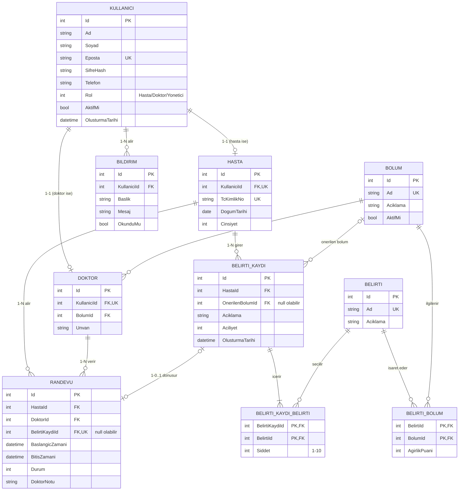

# ER Diyagramı

GitHub bu diyagramı otomatik olarak çizer (Mermaid).

## İlişki özeti

| İlişki | Tür | Nasıl kuruldu |
|---|---|---|
| Kullanici – Hasta | 1-1 | `Hasta.KullaniciId` FK + benzersiz |
| Kullanici – Doktor | 1-1 | `Doktor.KullaniciId` FK + benzersiz |
| Kullanici – Bildirim | 1-N | `Bildirim.KullaniciId` FK |
| Bolum – Doktor | 1-N | `Doktor.BolumId` FK |
| Hasta – Randevu | 1-N | `Randevu.HastaId` FK |
| Doktor – Randevu | 1-N | `Randevu.DoktorId` FK |
| Hasta – BelirtiKaydi | 1-N | `BelirtiKaydi.HastaId` FK |
| BelirtiKaydi – Randevu | 1-0..1 | `Randevu.BelirtiKaydiId` FK (null olabilir, benzersiz) |
| Belirti – Bolum | N-N | `BelirtiBolum` ara tablosu, birleşik PK |
| BelirtiKaydi – Belirti | N-N | `BelirtiKaydiBelirti` ara tablosu, birleşik PK |

## Normalizasyon notları

- **1NF:** Her alan tek değer tutar. Bir kayıttaki birden fazla belirti virgülle tek sütuna yazılmaz, `BelirtiKaydiBelirti` tablosunda ayrı satırlar olarak tutulur.
- **2NF:** Birleşik anahtarlı tablolarda (`BelirtiBolum`, `BelirtiKaydiBelirti`) anahtar dışı alanlar (`AgirlikPuani`, `Siddet`) anahtarın tamamına bağlıdır, bir parçasına değil.
- **3NF:** Geçişli bağımlılık yoktur. Örneğin randevunun bölümü `Randevu` tablosunda tutulmaz, çünkü bölüm doktordan belirlenir (Randevu → Doktor → Bolum). Hastanın adı ve soyadı `Hasta` tablosunda tekrar edilmez, `Kullanici` tablosundan gelir.
