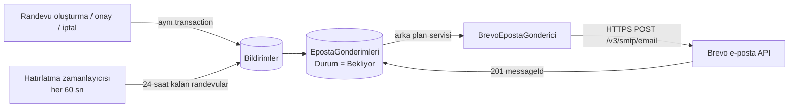

# Randevu Bildirim Entegrasyonu (Hafta 9)

Randevu onayları, iptaller ve hatırlatmalar hem **uygulama içinde** (Bildirimler sayfası) gösterilir hem de harici bir **e-posta API'si** üzerinden gönderilir.

## Akış



| Parça | Dosya | Görevi |
|---|---|---|
| `BildirimService` | `Business/Bildirimler/BildirimService.cs` | Uygulama içi bildirimi oluşturur, e-posta için giden kutusuna kayıt ekler |
| `HatirlatmaServisi` | `Business/Bildirimler/HatirlatmaServisi.cs` | 24 saat içinde başlayacak, beklemede ya da onaylı randevulara **bir kez** hatırlatma oluşturur |
| `EpostaKuyrugu` | `Business/Bildirimler/EpostaKuyrugu.cs` | Bekleyen e-postaları gönderir, sonucu kaydeder |
| `BrevoEpostaGonderici` | `Business/Bildirimler/BrevoEpostaGonderici.cs` | REST API çağrısı, yanıt ayrıştırma ve hata yönetimi |
| `BildirimArkaPlanServisi` | `Business/Bildirimler/BildirimArkaPlanServisi.cs` | Uygulamayla birlikte arka planda çalışan zamanlayıcı (`BackgroundService`) |

### Neden giden kutusu (outbox)?
E-posta, randevu kaydedilirken hemen gönderilmez. Önce `EpostaGonderimleri` tablosuna **"Bekliyor"** olarak yazılır, arka plan servisi daha sonra gönderir. Bunun üç faydası var:
- Randevu kaydı, dış bir servisin yanıtını beklerken veritabanı kilidini tutmaz.
- E-posta servisi çökse bile randevu alınabilir; e-posta sonra tekrar denenir.
- Her gönderimin durumu, deneme sayısı ve son hatası kayıtlıdır.

## Veri modeli

| Tablo / alan | Açıklama |
|---|---|
| `EpostaGonderimleri` (yeni) | Bildirim 1–N EpostaGonderimi: `Alici`, `Durum` (Bekliyor/Gönderildi/Başarısız/Atlandı), `DenemeSayisi`, `SonHata`, `DisMesajId`, `GonderimTarihi` |
| `Randevular.HatirlatmaTarihi` (yeni) | Hatırlatmanın oluşturulduğu an. Boş değilse randevu tekrar hatırlatılmaz |

Migration: `Migrations/20261117120000_Hafta9Bildirim.cs`

## Hatırlatma zamanlaması
- Arka plan servisi her `Bildirim:TurAraligiSaniye` (varsayılan 60) saniyede bir çalışır.
- **Kural:** Randevuya `HatirlatmaSaatOnce` (varsayılan 24) saat ya da daha az kalmışsa, randevu beklemede veya onaylıysa ve `HatirlatmaTarihi` boşsa hatırlatma gönderilir.
- Bildirim oluşturma ile `HatirlatmaTarihi` işaretleme **aynı transaction** içinde yapılır. Bu yüzden servis kaç kez çalışırsa çalışsın aynı randevuya ikinci hatırlatma gitmez.
- İptal edilen randevular hatırlatılmaz.

## API çağrısı ve yanıt ayrıştırma
```
POST https://api.brevo.com/v3/smtp/email
api-key: <ortam değişkeninden>
{ "sender": {"name","email"}, "to": [{"email"}], "subject", "textContent" }

201 → { "messageId": "<...>" }                 → DisMesajId olarak saklanır
4xx/5xx → { "code": "...", "message": "..." }  → SonHata olarak saklanır
```
Yanıtlar `System.Text.Json` (`JsonDocument`) ile okunur. Yanıt beklenen biçimde değilse uygulama çökmez, ham metnin ilk 200 karakteri hata olarak kaydedilir.

## Hata yönetimi

| Durum | Davranış |
|---|---|
| Zaman aşımı (her deneme en fazla 10 sn) | Geçici hata, tekrar denenir |
| Bağlantı hatası | Geçici hata, tekrar denenir |
| **429 hız sınırı (rate limit)** | Geçici hata; `Retry-After` başlığı kadar beklenir (en fazla 30 sn) |
| 408, 5xx | Geçici hata; üstel bekleme (1 sn, 2 sn, …) |
| 400 (geçersiz adres), 401 (yanlış anahtar) gibi diğer 4xx | **Kalıcı hata**, tekrar denenmez, kayıt "Başarısız" olur |
| Bir gönderimde 3 HTTP denemesi tükendi | Kayıt "Bekliyor" kalır, sonraki turda tekrar denenir |
| Kuyrukta toplam 5 deneme aşıldı | "Başarısız" |
| API anahtarı yok | Hiç istek atılmaz, kayıt "Atlandı" olur; bildirim uygulama içinde yine görünür |

Kendi hız sınırımız: her turda en fazla `TurBasinaEnFazlaEposta` (20) e-posta gönderilir.

## API anahtarının saklanması
- Anahtar **depoda yok.** `appsettings.json` dosyasında bu alan bilerek boş bırakıldı.
- Canlı ortamda ortam değişkenleri: `Eposta__ApiAnahtari`, `Eposta__GondericiAdres` (Brevo'da doğrulanmış gönderici).
- Geliştirmede: `dotnet user-secrets set "Eposta:ApiAnahtari" "..." --project src/AkilliRandevu.Web`
- Anahtar loglara ve hata mesajlarına yazılmaz. Bu, bir testle de doğrulanıyor.
- **Demo yönlendirmesi:** Sentetik kullanıcıların adresleri (`@ornek.test`) gerçek olmadığı için `Eposta__YonlendirmeAdresi` ayarlanırsa bütün e-postalar bu adrese gider. Asıl alıcı e-posta metnine yazılır.

## Nasıl gösterilir?
1. Yönetici olarak giriş yap → **E-posta** sayfası: servisin durumu ve son gönderimler.
2. **Test e-postası gönder:** API'yi doğrudan çağırır ve sonucu gösterir. Anahtar yoksa "yapılandırılmamış" der; yanlış anahtarda 401 hatasını gösterir.
3. Hasta olarak randevu al → doktor olarak onayla → hastanın **Bildirimler** sayfasında bildirim ve e-posta durumu görünür.

## Testler (`tests/AkilliRandevu.Tests/Bildirim`)
- Başarılı yanıtta `messageId` ayrıştırılıyor, anahtar başlıkta gidiyor.
- 429'da `Retry-After` kadar bekleniyor, sonra başarılı oluyor.
- 5xx'te üstel beklemeyle 3 deneme yapılıyor.
- 400 ve 401 kalıcı hata sayılıyor ve tekrar denenmiyor; anahtar hata mesajında görünmüyor.
- Yanıt gelmezse zaman aşımı oluşuyor.
- Anahtar yoksa hiç istek atılmıyor.
- Hatırlatma 24 saat kuralına uyuyor ve aynı randevuya bir kez gidiyor; iptal edilmiş randevu hatırlatılmıyor.
- Giden kutusunda geçici hatada tekrar deneniyor, deneme sınırında "Başarısız" oluyor, kalıcı hatada tekrar denenmiyor, demo yönlendirmesi çalışıyor.
