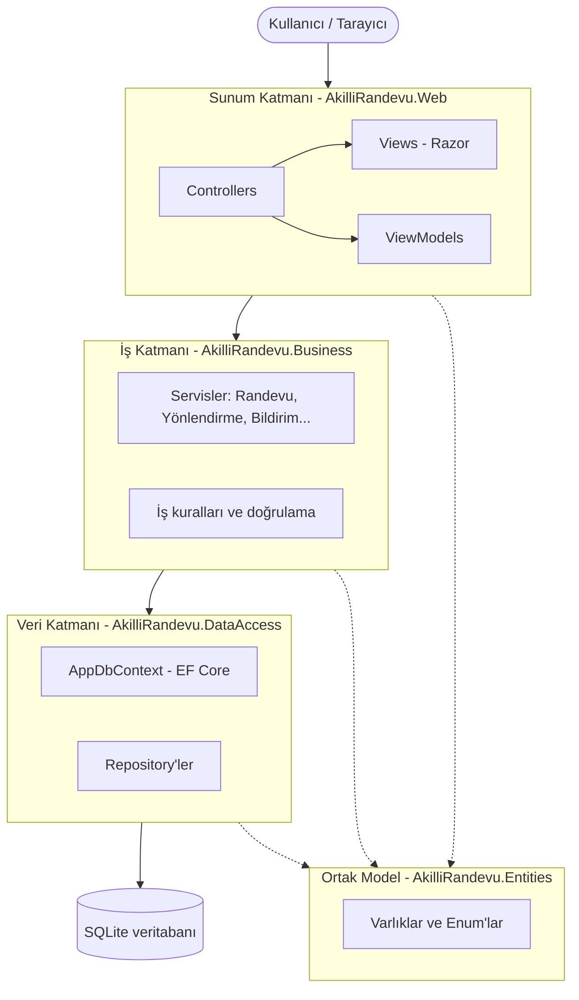

# Mimari Şema

Proje **katmanlı mimari** (N-Tier) ile kuruldu: sunum, iş ve veri katmanları birbirinden ayrıdır. Her katman yalnızca altındaki katmanı tanır.



## Katmanlar

| Proje | Katman | Sorumluluğu | Referans verdiği projeler |
|---|---|---|---|
| `AkilliRandevu.Web` | Sunum | HTTP isteklerini karşılar, sayfaları gösterir (ASP.NET Core MVC) | Business, Entities |
| `AkilliRandevu.Business` | İş | Randevu çakışma kontrolü, belirtiye göre bölüm önerme, bildirim kuralları | DataAccess, Entities |
| `AkilliRandevu.DataAccess` | Veri | Veritabanı erişimi (EF Core, SQLite) | Entities |
| `AkilliRandevu.Entities` | Ortak model | Tablolara karşılık gelen sınıflar ve enum'lar | (hiçbiri) |

Web katmanı veritabanına doğrudan erişemez, çünkü DataAccess projesini referans almaz. Her şey iş katmanı üzerinden geçer.

## Klasör yapısı

```
akilli_randevu-asistani/
├── AkilliRandevu.sln
├── README.md
├── .gitignore
├── docs/                     → ER diyagramı, mimari şema
└── src/
    ├── AkilliRandevu.Web/         → Controllers, Views, wwwroot
    ├── AkilliRandevu.Business/    → servisler (ilerleyen haftalarda)
    ├── AkilliRandevu.DataAccess/
    │   └── Context/               → AppDbContext
    └── AkilliRandevu.Entities/
        ├── Common/                → BaseEntity
        ├── Concrete/              → Kullanici, Hasta, Randevu...
        └── Enums/                 → Rol, RandevuDurumu...
```

## Neden bu yapı?

- **Sorumlulukların ayrılması:** Arayüz değişince iş kuralları, veritabanı değişince arayüz etkilenmez.
- **Test edilebilirlik:** İş katmanı arayüzden bağımsız olarak test edilebilir.
- **Bakım ve ekip çalışması:** Hangi kodun nereye yazılacağı bellidir.
- **Entities ayrı projede:** Varlıklar tüm katmanlarda kullanılır. Ayrı projede olunca döngüsel referans oluşmaz.
