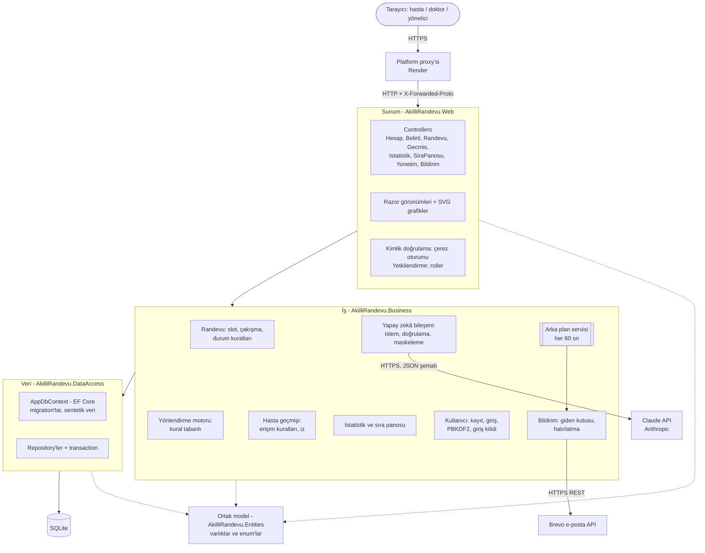

# Mimari Şema

Proje **katmanlı mimari** (N-Tier) ile kuruldu: sunum, iş ve veri katmanları birbirinden ayrıdır. Her katman yalnızca altındaki katmanı tanır. Dış servisler (yapay zekâ, e-posta) iş katmanındaki arayüzlerin arkasındadır; testlerde sahteleriyle değiştirilebilirler.



## Katmanlar

| Proje | Katman | Sorumluluğu | Referans verdiği projeler |
|---|---|---|---|
| `AkilliRandevu.Web` | Sunum | HTTP isteklerini karşılar, sayfaları üretir, oturum ve rolleri uygular (ASP.NET Core MVC) | Business, Entities |
| `AkilliRandevu.Business` | İş | Bütün iş kuralları, dış servis istemcileri, arka plan servisi | DataAccess, Entities |
| `AkilliRandevu.DataAccess` | Veri | Veritabanı erişimi (EF Core, SQLite), migration'lar, sorgular | Entities |
| `AkilliRandevu.Entities` | Ortak model | Tablolara karşılık gelen sınıflar ve enum'lar | (hiçbiri) |
| `AkilliRandevu.Tests` | Test | Birim, bileşen ve web testleri | Hepsi |

Web katmanı veritabanına doğrudan erişmez; her şey iş katmanı üzerinden geçer.

## İş katmanı modülleri

| Klasör | Hafta | İçerik |
|---|---|---|
| `Concrete/` | 5–7 | `KullaniciService`, `RandevuService`, `BelirtiService`, `Pbkdf2SifreHasher`, `PoliklinikSaati` |
| `Takvim/` | 6 | `TakvimAyarlari`, `SlotUretici`, `RandevuDurumKurallari` |
| `Yonlendirme/` | 7 | `YonlendirmeMotoru` (kural tabanlı bölüm önerisi ve aciliyet) |
| `Bildirimler/` | 9 | `BrevoEpostaGonderici`, `EpostaKuyrugu`, `HatirlatmaServisi`, `BildirimArkaPlanServisi` |
| `YapayZeka/` | 10 | `ClaudeYapayZekaIstemcisi`, `BolumOneriAsistani`, `YzCiktiDogrulayici`, `KisiselVeriMaskeleyici` |
| `Gecmis/` | 11 | `HastaGecmisiService` |
| `Istatistik/` | 12 | `IstatistikHesaplayici`, `IstatistikService`, `CsvYazici` |

## Klasör yapısı

```
akilli_randevu-asistani/
├── AkilliRandevu.sln
├── README.md
├── Dockerfile, .dockerignore, render.yaml   → dağıtım
├── dotnet-tools.json                        → dotnet-ef, reportgenerator
├── .github/workflows/ci.yml                 → derleme, migration kontrolü, testler, kapsam, Docker
├── docs/                                    → belgeler
├── src/
│   ├── AkilliRandevu.Web/          → Controllers, Views, Models, Infrastructure, ViewComponents, wwwroot
│   ├── AkilliRandevu.Business/     → Abstract, Concrete, Dtos, Takvim, Yonlendirme, Bildirimler, YapayZeka, Gecmis, Istatistik
│   ├── AkilliRandevu.DataAccess/   → Abstract, Concrete (repository'ler), Context (DbContext, sentetik veri), Migrations
│   └── AkilliRandevu.Entities/     → Common, Concrete, Enums
└── tests/
    └── AkilliRandevu.Tests/        → Kurallar, Bildirim, YapayZeka, Gecmis, Istatistik, Veritabani, Entegrasyon
```

## Neden bu yapı?

- **Sorumlulukların ayrılması:** Arayüz değişince iş kuralları, veritabanı değişince arayüz etkilenmez.
- **Test edilebilirlik:** Hesap mantığı (yönlendirme motoru, slot üretici, istatistik) saf sınıflarda; dış servisler arayüz arkasında. Bu yüzden testler hızlı çalışıyor ve sonuçları her seferinde aynı.
- **Dış servislere bağımlılığın sınırlanması:** Claude ya da Brevo çökerse uygulama çalışmaya devam eder: kural tabanlı öneri ve uygulama içi bildirim her zaman var.
- **Entities ayrı projede:** Varlıklar bütün katmanlarda kullanılır; ayrı projede olunca döngüsel referans oluşmaz.

Ayrıntılar: [teknik-dokumantasyon.md](teknik-dokumantasyon.md)
