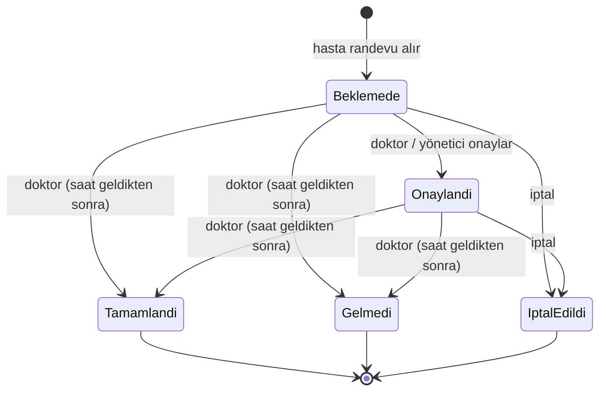

# Randevu Takvimi ve Yönetimi Modülü

## Veri modeli

| Parça | Nerede | Açıklama |
|---|---|---|
| Randevu | `Randevular` tablosu | Hasta, doktor, başlangıç–bitiş zamanı, durum, isteğe bağlı belirti kaydı |
| Slot | Veritabanında **yok**, ayardan üretilir (`SlotUretici`) | Doktorun takvimindeki tek bir zaman aralığı |
| Çalışma düzeni | `appsettings.json` → `Takvim` (`TakvimAyarlari`) | Mesai 09:00–17:00, öğle arası 12:00–13:00, 20 dk slot, hafta sonu kapalı |
| Bildirim | `Bildirimler` tablosu | Randevu oluşturma, onay ve iptal olaylarında hasta ve doktora yazılır |

Slotlar tabloda tutulmuyor, çünkü boş slotu satır olarak saklamak gereksiz veri üretir ve çalışma saati değişince binlerce satırın güncellenmesi gerekir. Doluluk her seferinde mevcut randevulardan hesaplanıyor. Bir randevunun bölümü ayrıca tutulmuyor, doktordan türetiliyor (3NF).

## Randevu durumları

Geçiş tablosu ve rol/zaman kuralları: `Business/Takvim/RandevuDurumKurallari.cs`.

## İş kuralları

### Randevu oluştururken (`RandevuService.OlusturAsync`)
1. Geçmiş bir saate randevu alınamaz.
2. En fazla 30 gün sonrasına randevu alınabilir.
3. Saat, çalışma düzenindeki bir slotun başlangıcı olmalı. Mesai dışı, öğle arası, hafta sonu ve 09:07 gibi slot başına denk gelmeyen saatler reddedilir.
4. Doktorun kullanıcı hesabı ve bölümü aktif olmalı.
5. **Doktor çakışması:** Doktorun o aralıkta iptal edilmemiş başka randevusu olamaz.
6. **Hasta çakışması:** Hastanın aynı saatte, başka bir doktorda bile, randevusu olamaz.
7. Hastanın aynı bölümde ileri tarihli tek bir aktif (beklemede ya da onaylı) randevusu olabilir. Böylece slot stoklanamaz.
8. Belirti kaydı verilirse, kayıt o hastaya ait olmalı.

5., 6. ve 7. kontroller ile kayıt işlemi **tek bir transaction** içinde yapılır. SQLite'ta `BEGIN IMMEDIATE` ile yazma kilidi baştan alınır. Böylece iki hasta aynı anda aynı slota istek gönderse bile yalnızca biri kaydedilir. Bu durum 5 eşzamanlı istekle denendi ve tek kayıt oluştu.

### Durum değiştirirken (`RandevuService.DurumDegistirAsync`)
| Kural | Neden |
|---|---|
| Hasta yalnızca kendi randevusunu, doktor yalnızca kendi randevusunu değiştirebilir | Sahiplik kontrolü (IDOR koruması) |
| Hasta onaylayamaz, sadece iptal edebilir | Onay doktorun ve polikliniğin işi |
| Hasta en geç 2 saat öncesine kadar iptal edebilir | Son dakika iptalinde slot başka hastaya verilemez |
| Başlamış randevu iptal edilemez ya da onaylanamaz | Geçmiş değiştirilmesin |
| Tamamlandı/Gelmedi sonucunu yalnızca doktor ve saat geldikten sonra girebilir | Muayene sonucu tıbbi bir kayıt |
| Tamamlandı, Gelmedi ve İptal edildi son durumlardır | Kapanmış kayıt tekrar açılmasın |

İptal edilen randevunun slotu tekrar boş görünür ve başka bir hasta alabilir.

## Diğer modüllerle entegrasyon
| Modül | Bağlantı |
|---|---|
| Kimlik doğrulama (Hafta 5) | Hasta ve doktor kimliği oturumdan alınır (`User.ToIslemci()`). Sayfalar `[Authorize(Roles)]` ile korunur |
| Veri katmanı (Hafta 4) | Yeni sorgular `EfRandevuRepository` içinde ve mevcut indeksleri kullanıyor. Transaction için `IIslemYoneticisi` |
| Bildirim | Her olayda `Bildirimler` tablosuna kayıt düşer |
| Belirti / bölüm yönlendirme (ileride) | `OlusturAsync` metodu `belirtiKaydiId` parametresi alıyor. Yönlendirmeden gelen randevu belirti kaydına bağlanacak |
| Hasta geçmişi | "Randevularım" sayfası tüm durumları listeliyor |

## Ekranlar
| Rol | Sayfa | İşlev |
|---|---|---|
| Hasta | `/Randevu/Al` | Bölüm → doktor → gün → boş saat seçimi |
| Hasta | `/Hasta/Randevularim` | Randevu listesi, iptal |
| Doktor | `/Doktor/Takvim` | Günün bütün slotları, onayla / iptal / tamamlandı / gelmedi |
| Yönetici | `/Yonetim/Randevular` | Günün bütün randevuları, bölüm filtresi, onayla / iptal |

Butonlar `IzinVerilenDurumlar` metoduna göre gösterilir. Butonu gizlemek yalnızca kolaylık sağlar, asıl kontrol sunucuda tekrar yapılır.
